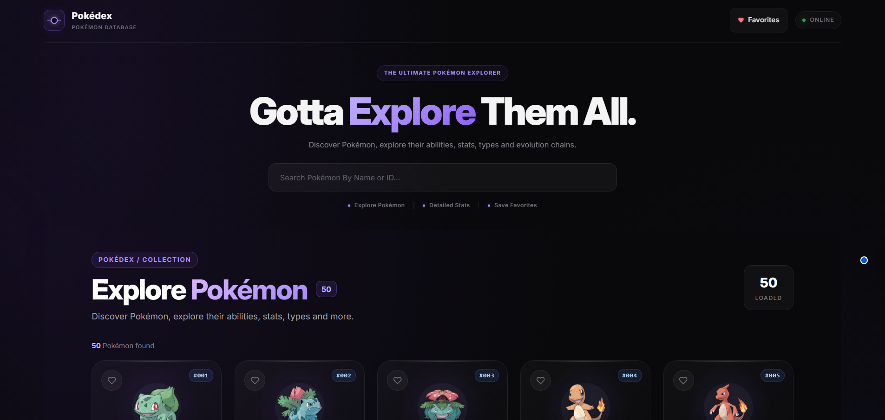

# Pokédex — Explore the Pokémon World

A responsive Pokémon explorer built with **React** and **Vite**. Browse Pokémon, search the collection, inspect detailed stats and abilities, follow evolution chains, understand type matchups, discover similar Pokémon, and save your favourites.

> **Live Demo:** [https://pokedex-zeta-tawny.vercel.app](https://pokedex-zeta-tawny.vercel.app)  
> **Source Code:** [https://github.com/Mithlesh-16/pokedex](https://github.com/Mithlesh-16/pokedex)

<!-- SCREENSHOT 1: Replace the path below with your main/homepage screenshot.
     Recommended: capture the full hero section and the first row of Pokémon cards.
     Save the image in a folder such as docs/screenshots/ and update the path. -->


---

## Table of Contents

- [Overview](#overview)
- [Features](#features)
- [Screenshots](#screenshots)
- [Tech Stack](#tech-stack)
- [How It Works](#how-it-works)
- [Project Structure](#project-structure)
- [Getting Started](#getting-started)
- [Available Scripts](#available-scripts)
- [API Reference](#api-reference)
- [Performance and Data Handling](#performance-and-data-handling)
- [Current Scope](#current-scope)
- [Future Improvements](#future-improvements)
- [Acknowledgements](#acknowledgements)
- [Author](#author)

## Overview

Pokédex is a single-page web application for exploring Pokémon data through a clean, interactive interface. Instead of displaying only a list of names and images, the application brings together useful information from the PokéAPI and presents it through dedicated views.

The project started as a React-based Pokédex and gradually grew into a more feature-rich explorer. During development, I focused on reusable components, custom hooks, client-side routing, API data handling, caching, and state management.

The application currently includes a Pokémon collection page, individual Pokémon detail pages, an evolution-chain visualisation, type-effectiveness information, similar Pokémon suggestions, and a favourites collection.

## Features

### 1. Pokémon Collection

- Browse Pokémon in a card-based grid.
- Load Pokémon data from the PokéAPI.
- Load additional Pokémon using the API's pagination URLs.
- View each Pokémon's artwork, name, Pokédex number, and type information.
- Search Pokémon by name through the home-page search field.

<!-- SCREENSHOT 2: Add a screenshot of the Pokémon listing/grid.
     Ideally show several cards and the search field.
     Suggested file: docs/screenshots/pokemon-grid.png -->

### 2. Pokémon Details

Each Pokémon has a dedicated details page containing:

- Official Pokémon artwork.
- Pokédex number and name.
- Pokédex description.
- Height, weight, and species.
- Pokémon types and abilities.
- Base statistics with a visual bar chart.
- Moves list.
- Previous and next Pokémon navigation.

<!-- SCREENSHOT 3: Add a screenshot of an individual Pokémon details page.
     Include the artwork, attributes and stats chart if possible.
     Suggested file: docs/screenshots/pokemon-details.png -->

### 3. Evolution Chain

Explore how a Pokémon evolves and how it is connected to other Pokémon.

- Fetch the Pokémon species information.
- Retrieve the associated evolution-chain resource.
- Traverse the evolution tree to identify parent and child relationships.
- Represent the evolution relationships visually.

<!-- SCREENSHOT 4: Add a screenshot showing an evolution chain.
     Choose a Pokémon with multiple evolution stages or branches.
     Suggested file: docs/screenshots/evolution-chain.png -->

### 4. Type Effectiveness

Understand Pokémon type matchups using data from the PokéAPI.

- Fetch type information for the selected Pokémon.
- Display defensive type relationships.
- Identify double-damage, half-damage, and no-damage matchups.
- Support Pokémon with one or more types.

<!-- SCREENSHOT 5: Add a screenshot of the Type Effectiveness section.
     Make sure the matchup groups and damage multipliers are readable.
     Suggested file: docs/screenshots/type-effectiveness.png -->

### 5. Similar Pokémon

Discover other Pokémon that share type characteristics with the currently selected Pokémon.

- Retrieve data for the Pokémon's types.
- Use type relationships to identify related Pokémon.
- Aggregate matches across the selected Pokémon's types.
- Exclude the currently viewed Pokémon from the suggestions.

<!-- SCREENSHOT 6: Add a screenshot of the Similar Pokémon section.
     Suggested file: docs/screenshots/similar-pokemon.png -->

### 6. Favourites

Build a personal collection of Pokémon.

- Add or remove Pokémon from favourites.
- Persist favourites in the browser using localStorage.
- Search within the favourites collection.
- Filter favourites using available Pokémon properties such as types, abilities, species, and moves.
- Sort the collection by Pokédex number, name, and base-stat values.
- Switch between summary and expanded Pokémon cards.

<!-- SCREENSHOT 7: Add a screenshot of the Favourites page.
     Ideally show the filters, sort controls, and saved Pokémon cards.
     Suggested file: docs/screenshots/favourites.png -->

### 7. Responsive Interface

The interface is designed to provide a consistent browsing experience across different screen sizes.

<!-- SCREENSHOT 8 (OPTIONAL): Add a mobile screenshot showing the home page or Pokémon details.
     Suggested file: docs/screenshots/mobile-view.png -->

## Screenshots

The screenshots referenced above should be added to the repository under:

```text
docs/
└── screenshots/
    ├── home.png
    ├── pokemon-grid.png
    ├── pokemon-details.png
    ├── evolution-chain.png
    ├── type-effectiveness.png
    ├── similar-pokemon.png
    ├── favourites.png
    └── mobile-view.png
```

Create the folder and add your screenshots using the filenames above, or update the image paths in this README to match your filenames. The mobile screenshot is optional.

## Tech Stack

| Technology | Purpose |
|---|---|
| React | Building the user interface with reusable components |
| Vite | Development server and production build tooling |
| JavaScript (ES Modules) | Application logic |
| React Router | Client-side navigation between pages |
| Axios | Making HTTP requests to the PokéAPI |
| React Context API | Sharing favourites state across components |
| localStorage | Persisting the favourites collection in the browser |
| CSS | Styling and responsive layouts |
| React Icons | Interface icons |
| PokéAPI | Pokémon, species, evolution, and type data |

## How It Works

### Application Routes

| Route | Description |
|---|---|
| `/` | Pokémon collection and search |
| `/pokemon/:id` | Details for a Pokémon identified by its Pokédex ID |
| `/favorites` | User's locally saved Pokémon collection |

### Data Flow

1. The home page renders the Pokémon collection.
2. The Pokémon list hook requests a paginated collection from the PokéAPI.
3. Individual Pokémon resources are fetched to obtain artwork and information required by the cards.
4. Selecting a Pokémon opens its details route.
5. The Pokémon service checks its in-memory cache before making another request.
6. The details page renders the Pokémon information and its supporting sections.
7. Additional hooks fetch evolution-chain and type data when those sections need it.
8. The favourites context manages saved Pokémon and synchronises the collection with localStorage.

### Custom Hooks and Services

| Module | Responsibility |
|---|---|
| `usePokemonList` | Fetches Pokémon lists, manages loading/error state, and loads additional pages |
| `useEvolutionChain` | Retrieves and traverses evolution-chain data |
| `useTypeEffectiveness` | Fetches type matchup information and uses a type-data cache |
| `useFavorites` | Provides access to favourites context functionality |
| `pokemonService` | Fetches individual Pokémon data and avoids duplicate requests through in-memory caching |
| `FavoritesContext` | Maintains favourites state and synchronises it with localStorage |

## Project Structure

The repository is organised into a frontend application and a server-side directory reserved for backend development.

```text
pokedex/
│
├── client/
│   ├── public/
│   ├── src/
│   │   ├── components/
│   │   │   ├── Error/
│   │   │   ├── Evolution/
│   │   │   ├── Loader/
│   │   │   ├── PokemonCard/
│   │   │   ├── PokemonGrid/
│   │   │   ├── SearchBar/
│   │   │   └── Type/
│   │   │
│   │   ├── context/
│   │   │   └── FavoritesContext.jsx
│   │   │
│   │   ├── hooks/
│   │   │   ├── UsePokemonList.jsx
│   │   │   ├── useEvolutionChain.jsx
│   │   │   ├── useFavorites.js
│   │   │   └── useTypeEffectiveness.jsx
│   │   │
│   │   ├── pages/
│   │   │   ├── Favorites/
│   │   │   ├── Home/
│   │   │   └── PokemonDetails/
│   │   │
│   │   ├── routes/
│   │   │   └── AppRoutes.jsx
│   │   │
│   │   ├── services/
│   │   │   └── pokemonService.js
│   │   │
│   │   └── utils/
│   │       └── typeCache.js
│   │
│   ├── App.jsx
│   ├── main.jsx
│   ├── index.html
│   ├── package.json
│   └── vite.config.js
│
├── server/              # Backend structure reserved for future development
├── .gitignore
└── README.md
```

## Getting Started

### Prerequisites

Make sure you have the following installed:

- [Node.js](https://nodejs.org/) (a current LTS version is recommended)
- npm (included with Node.js)
- Git

### 1. Clone the repository

```bash
git clone https://github.com/Mithlesh-16/pokedex.git
cd pokedex
```

### 2. Move into the client directory

The runnable Vite application is located inside the `client` directory.

```bash
cd client
```

### 3. Install dependencies

```bash
npm install
```

### 4. Start the development server

```bash
npm run dev
```

Vite will print a local URL in the terminal. Open that URL in your browser to use the application.

### 5. Create a production build

```bash
npm run build
```

To preview the production build locally:

```bash
npm run preview
```

## Available Scripts

Run these commands from the `client` directory.

| Command | Description |
|---|---|
| `npm run dev` | Starts the Vite development server |
| `npm run build` | Builds the application for production |
| `npm run preview` | Serves the production build locally |
| `npm run lint` | Runs ESLint |

## API Reference

This project uses the public [PokéAPI](https://pokeapi.co/) to retrieve Pokémon information.

Some of the API resources used by the application include:

| Resource | Purpose |
|---|---|
| `/pokemon?limit=50&offset=0` | Retrieves a paginated Pokémon collection |
| `/pokemon/{id}` | Retrieves an individual Pokémon's data |
| `/pokemon-species/{id}` | Provides species information and Pokédex descriptions |
| `/evolution-chain/{id}` | Provides evolution-chain relationships |
| `/type/{name}` | Provides type matchup and damage-relation information |

All Pokémon data is retrieved from the PokéAPI. No API key is required for the public endpoints used by this frontend.

## Performance and Data Handling

A few implementation decisions help keep the application organised and reduce unnecessary work:

- **In-memory Pokémon cache:** The Pokémon service stores successfully fetched Pokémon data in a JavaScript `Map`, allowing later requests for the same Pokémon to reuse the existing result.
- **Pending-request tracking:** Requests already in progress are stored separately so multiple components requesting the same Pokémon can share one request.
- **Type-data cache:** Type matchup responses are cached in a reusable map to avoid repeatedly fetching the same type resource.
- **Favourites persistence:** The favourites collection is stored in localStorage, so it remains available after a browser refresh on the same browser and origin.
- **Reusable hooks:** Data fetching and stateful logic are separated from presentation components where appropriate.

## Current Scope

The public deployment and the currently committed frontend code are the primary working scope of this repository.

The repository also contains a `server/` directory with folders and placeholder files for a possible backend. The backend, authentication, cloud storage, and server-persisted teams/favourites are **not described as working features here** because those files are not implemented in the current codebase.

Favourites currently use browser localStorage. They are therefore specific to the browser and device where they were saved; they are not synchronised across accounts or devices.

## Future Improvements

Potential areas for further development include:

- Implementing backend APIs for user accounts and persistent data.
- Adding authentication and account-based favourites.
- Completing Pokémon team creation and team management.
- Adding a Pokémon comparison experience.
- Improving automated tests and error-handling coverage.
- Refining accessibility and responsive behaviour.
- Adding more advanced filtering and discovery options.

## Acknowledgements

- [PokéAPI](https://pokeapi.co/) for providing the Pokémon data.
- [Pokémon](https://www.pokemon.com/) and its creators for the Pokémon universe and related intellectual property.
- The React and Vite communities for the tools and ecosystem used to build this project.

Pokémon and all related names, characters, and assets are trademarks and property of their respective owners. This project is a fan-made, non-commercial learning project and is not affiliated with or endorsed by Nintendo, Game Freak, or The Pokémon Company.

## Author

**Mithlesh Kumar**

- GitHub: [@Mithlesh-16](https://github.com/Mithlesh-16)
- Project: [Pokédex](https://github.com/Mithlesh-16/pokedex)
- Live Demo: [pokedex-zeta-tawny.vercel.app](https://pokedex-zeta-tawny.vercel.app)

---

<p align="center">
  Built with React, curiosity, and a love for Pokémon.
</p>
